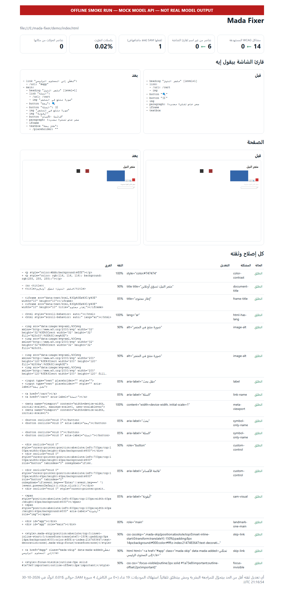

# Mada Fixer (مدى)

**An agent that finds accessibility problems on Arabic websites, fixes them with Meta models, and proves the improvement with numbers.**

Around 300 million people speak Arabic, yet many Arabic sites are unusable with a screen reader: controls are announced as "link", "img", "button" with no meaning, icon-only buttons have no name, keyboard users cannot see focus, and low-contrast Arabic text goes unnoticed by common tools. Mada Fixer reads the page like a user, understands it with Arabic-aware models, applies small fixes, and verifies them on the patched source.

Built for the **Meta Global AI Developer Hackathon** (Indie Developer track). See [docs/SUBMISSION.md](docs/SUBMISSION.md) for the compliance checklist.

## Meta models used

| Model | Where | What for |
|---|---|---|
| **Muse Spark 1.3** (`muse-spark-1.3`) | `src/understand/` via `POST /chat/completions` | Arabic alt text and `aria-label`s with a confidence score, plus a second critic pass that checks each proposal against the element's pixels |
| **Muse Wonder 1.0** (`muse-wonder-1.0`) | `src/fix/repoPatch.ts` | Maps verified fixes back to real source files as exact-string edits and produces a unified diff |
| **SAM 3.1** (`sam-3.1`) | `src/see/sam.ts` via `POST /responses` | Sees the screenshot like a user and finds icon-only or image controls that axe-core cannot see in the DOM |

All calls use the [Meta Model API](https://dev.meta.ai/docs/overview); model ids and the API base are configurable in `.env`.

## What it fixes (whole site, not just text)

| Layer | Problem | Fix |
|---|---|---|
| Names | images, buttons, links, icon/emoji-only buttons, iframes, ARIA widgets without a name | Spark writes Arabic text; the critic checks it against the pixels; low confidence goes to human review |
| Vision | visual controls with no accessible name that axe cannot flag | SAM 3.1 finds them on up to 3 screens, then they are named like above |
| Keyboard | clickable `div`/`span` (real click listeners found over CDP) | `role`, `tabindex=0`, Enter/Space handler |
| Focus | focus ring removed with `outline:none` (found by pressing Tab) | one `:focus-visible` rule |
| Page | missing `<title>`, `lang`, zoom blocked by `user-scalable=no` | AI title, `lang="ar"`, viewport rewritten |
| Navigation | no `main` landmark, no skip link | `role="main"` on the content block + Arabic skip link |
| Color | low contrast (including Arabic text that axe-core can skip) | text color moved toward black/white by the smallest passing step |
| Direction | Arabic page without `dir="rtl"` | suggested only; always sent to human review (it flips layout) |

Anything else axe reports (captions, heading order, complex tables, event delegation…) is listed under **needs human work** in the report and in the PR description — nothing is silently dropped.

## How it works

```
open page ─► SEE ──────────► UNDERSTAND ─────────► FIX ────────────► VERIFY
             Playwright DOM   Spark + critic        live DOM         axe-core + custom scans
             SAM 3.1 vision   (Arabic, confidence)  Muse Wonder      screen-reader transcript
             CDP listeners                          source diff      layout + pixel diff
             Tab focus probe
```

1. **See** — `src/see/`: DOM + screenshot, SAM discovery (one noun-phrase concept per request), click listeners through the DevTools protocol, a Tab-key focus probe.
2. **Understand** — `src/understand/`: Spark proposes; a second call critiques against the cropped element; final confidence = min(generator, critic). Below `MIN_CONFIDENCE` the fix is *not* applied.
3. **Fix** — `src/fix/`: applied to the live page with a before/after diff. With `--repo`, Wonder maps the same fixes to a copy of the source (one repair round for unmatched edits) and writes `fixes.diff`.
4. **Verify** — `src/verify/`: on the real patched source in repo mode: axe-core, our own scans, the screen-reader transcript, layout shift (no element may move) and a pixel diff.

Model output is untrusted JSON: every field is validated (`src/validate.ts`), missing/wrong values are skipped, confidence is clamped, and an invalid critic response can only lower confidence.

## Quickstart

```bash
npm install
npx playwright install chromium
cp .env.example .env          # paste MODEL_API_KEY (Linux/macOS); on Windows copy the file
npm run check                 # live check of Spark, Wonder and SAM (costs a few calls)
npm run test                  # typecheck + units + offline end-to-end + robustness
npm run fix -- https://example.com
npm run fix -- https://example.com --audit            # measure only, no models, no changes
npm run fix -- file:///path/to/site/index.html --repo /path/to/site
npm run fix -- file:///path/to/site/index.html --repo /path/to/site --pr
```

`--repo` only accepts a `file://` page inside that repository. `--pr` creates a branch and commit in **your own** repo, then pushes and opens a PR if `gh` is authenticated. It refuses a dirty worktree, checks that the patch applies cleanly first, stages only the patched files, and restores the branch if anything fails.

### Output

`out/report.html` (self-contained, opens in a browser), `out/report.json`, `out/reader-before.txt` / `reader-after.txt`, `out/before.png` / `after.png`, and in repo mode `out/fixes.diff` + `out/repo-patched/`.

## Evidence, not adjectives

Every run reports:

- **targeted WCAG issues** (the rules the agent can fix) before → after;
- **nameless elements** counted from the accessibility tree (`ariaSnapshot`), i.e. what a screen reader would announce;
- **layout shift**: positions/sizes of every element before vs after; expected 0;
- **pixel diff** (pixelmatch): contrast fixes change pixels on purpose, everything else should not;
- **source diff**: edits, files, and any fix that could not be mapped back to source (with the reason).

The offline suite (`npm run smoke`, real Chromium + real axe-core + mock model) on the bundled broken demo reports **14 → 0 targeted issues**, **6 → 0 nameless elements**, **0 elements moved**, and a repo patch that applies with `git apply`. These numbers come from the **mock model**; run the commands with your key for live numbers, and use the numbers from *your* run in the demo video (see [docs/DEMO_SCRIPT.md](docs/DEMO_SCRIPT.md)).



*Screenshot of `out/report.html` from the offline smoke suite. The banner was added when capturing it: this is a **mock-model** run used to verify the pipeline, not evidence of live model quality.*

## Finding: axe-core can miss contrast on Arabic text

axe-core 4.14 has an icon-ligature heuristic (`text.isIconLigature`) that can treat joined Arabic script as an icon font and skip `color-contrast` for some fonts/phrases, while still checking Latin text on the same page. Mada Fixer adds a separate contrast scan for elements whose own text is Arabic (`src/verify/axe.ts`), using the same WCAG 1.4.3 thresholds, and fixes failures by moving the text color toward black or white until it passes. Verify on your browser/fonts before quoting this; details and a repro are in [docs/ARABIC-CONTRAST.md](docs/ARABIC-CONTRAST.md).

## Evaluation

`npm run eval` runs every page in [`eval/sites.csv`](eval/sites.csv) (two local fixtures + public Arabic sites), writes per-site `out/eval/<n>/report.html` and a table in `eval/results.csv`. It respects `robots.txt`, loads one page per site, spaces requests (`EVAL_DELAY_MS`), and supports `--audit` (no models), `--limit N`, `--only <site|category>` and `--ignore-robots`. Methodology and caveats: [docs/EVAL.md](docs/EVAL.md).

## Cost and safety

- Responses are cached in `.cache/`; `MAX_MODEL_CALLS`, `MAX_INPUT_TOKENS`, `MODEL_TIMEOUT_MS`, `MODEL_CONCURRENCY` cap spend and runaway loops; every run prints a rough cost estimate.
- Real sites are **read-only**: one page load, no forms, no logins, no PRs against sites you do not own; `robots.txt` is respected by the evaluation harness.
- `.env` is git-ignored. Never commit a key. The test mock never contacts the network.
- Fixes below the confidence threshold, layout-flipping suggestions (`dir="rtl"`) and unmapped source fixes are sent to a human, not applied.

## Limitations

- Repo mode is verified for static HTML. JSX/Vue/Svelte files are sent to Wonder, but only statically rendered results are measured.
- Not automated: captions/transcripts, heading structure, complex tables, click handlers attached to a parent (event delegation), server-rendered state behind a login.
- Arabic quality is model-generated; the critic and confidence threshold reduce but do not eliminate bad wording. Review the report before merging.
- `dir="rtl"` is intentionally review-only because it changes layout.

## Repository layout

```
cli.ts                  command line
src/see/                Playwright, SAM 3.1 discovery, element capture
src/understand/         Muse Spark generation + critic
src/fix/                live DOM fixes, structure fixes, Muse Wonder source patching
src/verify/             axe-core, custom scans, transcript, layout and pixel diffs
src/report/             self-contained HTML report
test/                   units, offline end-to-end (mock Meta API), robustness
eval/                   evaluation harness + sites.csv
docs/                   demo script, evaluation, Arabic-contrast finding, submission checklist
demo/                   deliberately broken Arabic pages used in tests and the demo
```

## Hackathon compliance (summary)

- New work created inside the building period (Oct 27 – Nov 4, 2026); the repository's first commit is the record.
- One public repository, MIT license, no third-party code or data without rights; the demo fixtures are original.
- Uses Meta models through the Meta Model API as required (Spark, Wonder, SAM 3.1). No medical advice, no political/war content, no generic RAG/image analyzer.
- The demo video (≤ 3 minutes) only shows features built here; see [docs/SUBMISSION.md](docs/SUBMISSION.md) for the full checklist and the manual steps (public push, video, submission form, credits).

No affiliation with Meta. Meta, Muse and SAM are trademarks of Meta Platforms, Inc.

## License

MIT — see [LICENSE](LICENSE).
