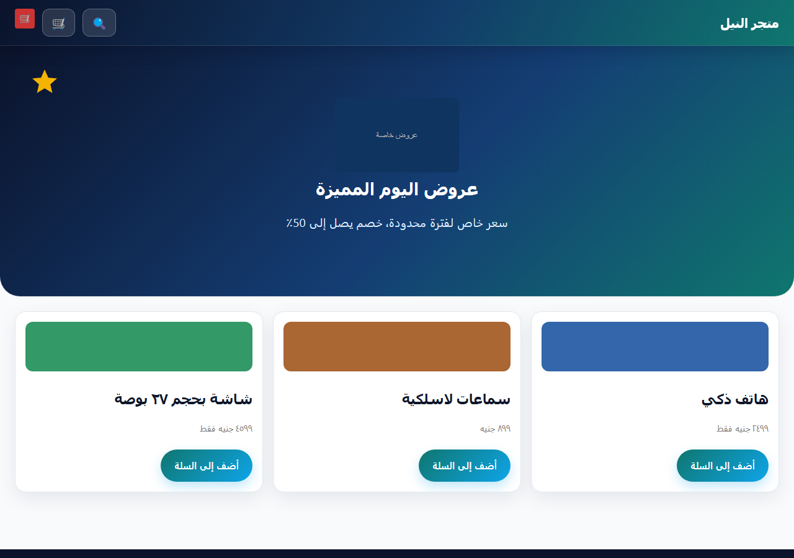
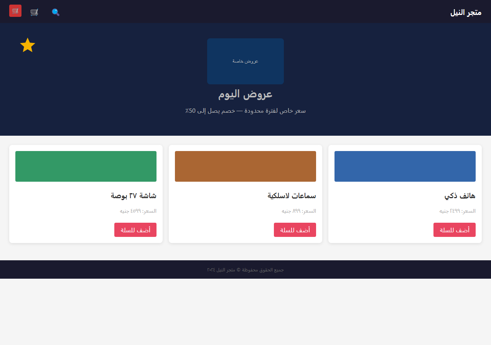
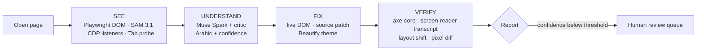
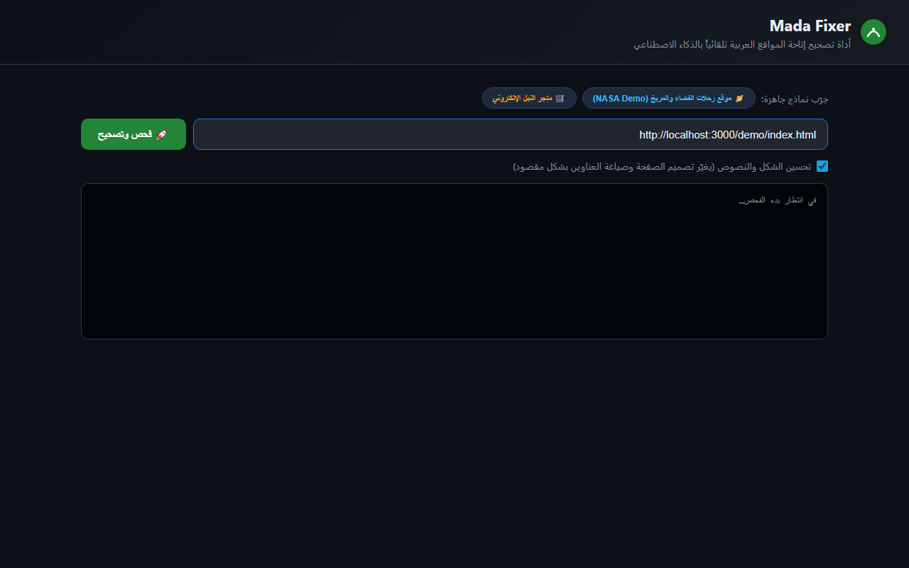
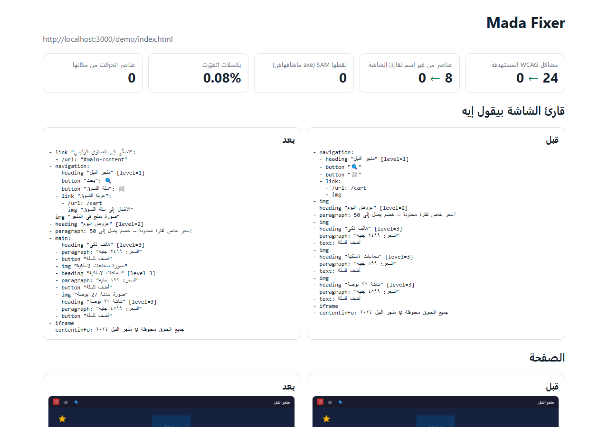

<p align="center">
  
</p>

<h1 align="center">Mada Fixer <span dir="rtl">(مدى)</span></h1>

<p align="center">
  <b>An accessibility agent for Arabic websites.</b><br>
  It sees the page like a user, writes the missing Arabic labels, fixes the DOM and the source,<br>
  and proves the result with measurements.
</p>

<p align="center">
  <a href="LICENSE"></a>
  
  
  
  
</p>

<p align="center">
  <a href="docs/DEMO_SCRIPT.md">Demo script</a> ·
  <a href="docs/SUBMISSION.md">Submission notes</a> ·
  <a href="docs/EVAL.md">Evaluation</a> ·
  <a href="docs/ARABIC-CONTRAST.md">Arabic contrast finding</a>
</p>

> Built for the **Meta Global AI Developer Hackathon** (Indie track). Every line of code in this repository was written during the event.

---

## Why

Arabic sites are full of elements a screen reader cannot describe: icon-only buttons, emoji links, images without `alt`, clickable `div`s, invisible focus rings, and low-contrast Arabic text that axe-core skips because joined script looks like an icon ligature. The result is a page that announces **"image, image, button, button"**.

Mada Fixer is not another audit report. It is an agent that **changes the page**, then re-audits the patched source and shows the numbers.

<table>
  <tr>
    <th align="center">Before</th>
    <th align="center">After (Beautify on)</th>
  </tr>
  <tr>
    <td></td>
    <td></td>
  </tr>
</table>

## What it fixes

| Layer | Problem | Fix |
|---|---|---|
| **Names** | images, buttons, links, icon/emoji-only buttons, iframes, ARIA widgets without a name | Spark writes Arabic text; a critic pass checks it against the pixels; low confidence goes to human review |
| **Vision** | controls with no accessible name that axe cannot flag | SAM 3.1 finds them in up to 3 screens, then they are named like above |
| **Keyboard** | clickable `div`/`span` (real click listeners found over CDP) | `role`, `tabindex="0"`, Enter/Space handler |
| **Focus** | focus ring removed with `outline:none` (found by pressing Tab) | one `:focus-visible` rule |
| **Page** | missing `<title>`, `lang`, zoom blocked by `user-scalable=no` | AI title, `lang="ar"`, viewport rewritten |
| **Navigation** | no `main` landmark, no skip link | `role="main"` on the content block + Arabic skip link |
| **Color** | low contrast, including Arabic text axe-core skips | text color moved toward black/white by the smallest passing step |
| **Direction** | Arabic page without `dir="rtl"` | suggested only; always sent to human review (it flips layout) |

Anything else axe reports (captions, heading order, complex tables, event delegation) is listed under **needs human work** in the report and the PR description — nothing is silently dropped.

## How it works



1. **See** — Playwright DOM and screenshots, SAM 3.1 discovery, real click listeners via CDP, a Tab-key focus probe.
2. **Understand** — Muse Spark proposes Arabic labels; a critic pass re-checks each proposal against the element's pixels. Final confidence is `min(generator, critic)`.
3. **Fix** — applied to the live page with a before/after diff. With `--repo`, Muse Wonder maps the same fixes back to the source files and emits a unified diff.
4. **Verify** — on the patched source in repo mode: axe-core plus custom scans, screen-reader transcript, layout-shift check (nothing may move), pixel diff.

## Models

| Model | Route | Used for |
|---|---|---|
| **Muse Spark 1.3** | Meta Model API · `POST /chat/completions` | Arabic alt text and `aria-label`s with confidence, critic pass, copy rewrites |
| **Muse Wonder 1.0** | Meta Model API | exact-string source edits and the unified diff in repo mode |
| **SAM 3.1** | Meta Model API · `POST /responses` | visual discovery of unlabeled controls |

Model ids and base URLs are configurable in `.env` (see `.env.example`).

**Model routing, stated plainly:** the Meta route is the default. If `MODEL_API_KEY` is empty or the Meta API fails, text calls can fall back to any OpenAI-compatible endpoint (Groq, Together, OpenRouter). Runs label fallback output with the provider tag (for example `[groq]`), and the report records provisional content. SAM is vision-only and requires the Meta route. The hackathon demo footage was recorded on the fallback text route because the Meta key was not provisioned at recording time; a run with `MODEL_API_KEY` set exercises all three Meta models.

## Quick start

```bash
git clone https://github.com/Kiro-404/Mada-Fixer.git
cd Mada-Fixer
npm ci
npx playwright install chromium
cp .env.example .env        # add MODEL_API_KEY (Meta) and optionally a fallback key
```

Fix the bundled demo:

```bash
npm run fix -- file://$PWD/demo/index.html --beautify
```

Or use the local web UI:

```bash
npm run serve               # http://localhost:3000
```

The UI opens the demo, streams the agent's progress, and shows the fixed page and the full report.

<p align="center">
  
</p>

### Repo mode (source patch + PR)

```bash
npm run fix -- file:///path/to/site/index.html --repo /path/to/site
git -C /path/to/site apply out/fixes.diff
```

Repo mode writes the patch into a copy of the source, verifies it on that copy, and produces `out/fixes.diff`. `npm run fix -- ... --repo ... --pr` additionally creates a branch and commit (the CLI never pushes).

## Beautify mode

Opt-in with `--beautify`, the UI checkbox, or `BEAUTIFY=1`. After the accessibility fixes, it applies one accessible theme (colors, spacing, type scale, cards, hero, buttons) and rewrites visible headings, prices, and CTAs with Spark.

Copy is rejected unless it keeps **every number**, adds no new claims, and passes the confidence threshold. The report labels the resulting pixel and layout changes as intentional (`beautifyApplied`, `textChanged`) instead of hiding them.

## What is measured

Every run reports, before → after:

- targeted WCAG issues (axe-core, filtered to what the tool can patch)
- elements with no name in the screen-reader transcript
- fixes applied and contrast fixes
- layout shift and pixel change (Beautify is the only intentional pixel change)

Recorded demo run on `demo/index.html`:

| Metric | Before | After |
|---|---|---|
| Targeted WCAG issues | 24 | **0** |
| Unnamed elements for a screen reader | 8 | **0** |
| Fixes applied | — | **36** |
| Pixels changed (Beautify, intentional) | — | **43.74%** |

<p align="center">
  
</p>

These figures come from the demo run used in the video, not a cross-site benchmark. `npm run eval` reproduces them on the sites listed in `eval/sites.csv`.

## Evaluation

```bash
npm run eval        # all sites in eval/sites.csv -> eval/results.csv
npm run quality     # reproducible sample of 50 generated texts -> eval/quality-sample.csv
npm run score       # accuracy overall and per confidence bucket
```

`npm run quality` writes a sample for human rating (`human_ok = 1/0`); `npm run score` then shows whether higher confidence really means more correct output. See [docs/EVAL.md](docs/EVAL.md).

## Tests

| Command | What it proves |
|---|---|
| `npm run typecheck` | the project compiles under strict TypeScript |
| `npm run units` | detectors and contrast math, in a real browser, no API keys |
| `npm run smoke` | the full loop offline: real browser, real axe-core, real git, mocked model API |
| `npm run test:robust` | bad JSON, CSP pages, hanging resources |
| `npm run test:open` | the open-weights routing path |

`npm run smoke` checks that targeted issues drop to 0, no element moves, repo mode verifies the patched source, and the branch/commit flow works. CI runs `typecheck`, `units`, and `smoke` on every push.

## Limitations

- Repo mode handles static HTML. JSX/Vue templates are sent to Muse Wonder but only verified when they render statically.
- Not automated (listed for a human): captions/transcripts, heading structure, complex tables, and click handlers attached to a parent (event delegation).
- Problems inside iframes and shadow roots are tested frame by frame and reported as `nested:<rule>` because they cannot be patched from the main page.
- Direction (`dir="rtl"`) is suggested, never applied automatically.
- Beautify is a theme, not a redesign of the information architecture; prices and product names never change.

## Responsible use

- Only test sites you are allowed to test. `npm run eval` skips sites whose `robots.txt` disallows `*`, waits between real sites, and closes the browser even after an error.
- The CLI never pushes and never opens a PR. Review the diff first.
- Secrets live in `.env` (gitignored). Nothing is sent anywhere except the model endpoints you configure; there is no telemetry.

## Project layout

```
cli.ts                 CLI: fix, repo mode, PR helper, reports
server.ts              local web UI with streamed progress
src/
  see/                 Playwright capture, CDP listeners, SAM 3.1
  understand/          Muse Spark proposals and the critic pass
  fix/                 DOM fixes, contrast, structure, Beautify, repo patch
  verify/              axe-core wrapper, Arabic contrast scan, visual diff
  report/html.ts       self-contained HTML report
test/                  unit, smoke, robustness, mock model server
eval/                  site list and quality scoring
scripts/               helpers and video production
docs/                  submission notes, evaluation, demo script
demo/                  the intentionally broken demo store
```

## Docs

- [Submission notes](docs/SUBMISSION.md) — requirements, verification, and the exact commands used.
- [Demo script](docs/DEMO_SCRIPT.md) — 3-minute English cut and the Arabic narration.
- [Evaluation](docs/EVAL.md) — sites, protocol, and results.
- [Arabic contrast finding](docs/ARABIC-CONTRAST.md) — why axe-core 4.14.0 skips joined Arabic script, and how the tool compensates.

## License

MIT — see [LICENSE](LICENSE).

Mada Fixer uses [axe-core](https://github.com/dequelabs/axe-core) (MPL-2.0) and [Playwright](https://playwright.dev) (Apache-2.0). Meta model names belong to Meta.
